 

## ⚡ Quem sou eu

  

 

## 🧩 O que eu construo

<table>
  <tr>
    <td width="33%" valign="top" align="center">
       
        
      <b>🎮 Sistemas para Roleplay</b>  
      Scripts em Lua, lógica de servidor e banco de dados feitos sob medida, pensados para escalar com a sua comunidade.
        
    </td>
    <td width="33%" valign="top" align="center">
       
        
      <b>🖥️ Interfaces Imersivas</b>  
      Front-ends leves, responsivos e com animações que fazem o jogador sentir que está dentro do mundo.
        
    </td>
    <td width="33%" valign="top" align="center">
       
        
      <b>🌐 CDN & Edge</b>  
      Cloudflare R2 e Workers para entregar assets em milissegundos, com armazenamento escalável e custo baixo.
        
    </td>
  </tr>
</table>

## 🛠️ Arsenal

  
  

## 📈 No GitHub

  

  

<picture>
  <source media="(prefers-color-scheme: dark)" srcset="https://raw.githubusercontent.com/SauloAPeixoto/SauloAPeixoto/output/snake-dark.svg" />
  <source media="(prefers-color-scheme: light)" srcset="https://raw.githubusercontent.com/SauloAPeixoto/SauloAPeixoto/output/snake-light.svg" />
  
</picture>

## 🚀 Projetos em destaque

> [!NOTE]
> 🚧 A vitrine está sendo montada. Enquanto isso, explore os [repositórios públicos](https://github.com/SauloAPeixoto?tab=repositories).

<!--
Quando quiser mostrar projetos, use este modelo (troque REPO e a descrição):

-->

## 💬 Bora tirar sua ideia do papel?

**Servidor precisando de sistemas exclusivos? Interface que impressione? Site que carrega num piscar de olhos?** 
É exatamente isso que eu faço.

 

